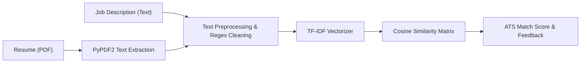

# 📄 AI Resume Analyzer & ATS Score Matcher

[](https://www.python.org/)
[](https://streamlit.io/)
[](https://scikit-learn.org/)
[](LICENSE)

An intuitive, interactive **Streamlit web application** designed to evaluate candidate resumes against target job descriptions using **Natural Language Processing (NLP)**, **TF-IDF vectorization**, and **Cosine Similarity** metric calculation.

---

## 🚀 Key Features

- 📑 **PDF Resume Ingestion:** Extracts text from uploaded PDF resumes in real-time using `PyPDF2`.
- 🔍 **Text Normalization & Preprocessing:** Cleans special characters, lowercases text, removes noise, and filters English stopwords.
- 🎯 **TF-IDF Vector Space Modeling:** Generates sparse vector embeddings for both the resume and the job description.
- 📐 **Cosine Similarity Matching:** Computes the angular similarity metric ($0 - 100\%$) indicating candidate qualification alignment.
- 💡 **Actionable Feedback:** Categorizes match strength (`🔥 Excellent match`, `⚡ Good match`, `📊 Moderate match`, `📉 Low match`) to guide resume tailoring.

---

## 🛠️ Architecture Flow



---

## 📂 Project Structure

```plaintext
ai-resume-analyzer/
├── app.py              # Streamlit web UI and user interaction logic
├── utils.py            # Text preprocessing, TF-IDF calculation, feedback mapper
├── requirements.txt    # Project dependencies
├── .gitignore          # Repository hygiene
└── README.md           # Documentation
```

---

## ⚡ Quickstart

### 1. Clone the Repository
```bash
git clone https://github.com/SLAYWITHME2005/ai-resume-analyzer.git
cd ai-resume-analyzer
```

### 2. Set Up Environment & Dependencies
```bash
python -m venv venv
# On Windows:
venv\Scripts\activate

pip install -r requirements.txt
```

### 3. Launch the Streamlit Web Application
```bash
streamlit run app.py
```
Open your browser at `http://localhost:8501`.

---

## 👩‍💻 Author
- **Gayathri Rajeev** ([@SLAYWITHME2005](https://github.com/SLAYWITHME2005))
